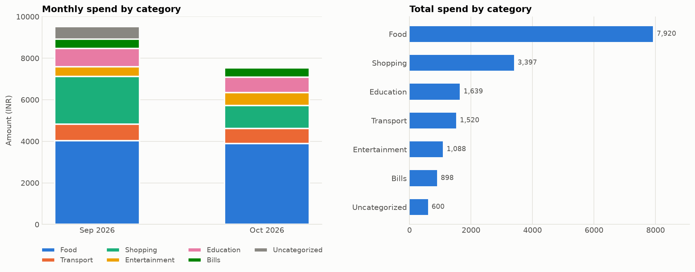

# Expense Analyzer

A small pandas script that takes a messy personal-expense CSV, cleans it, shows where the money goes, flags budget overruns and saves a chart.



## What it does

- **Cleans** the data: fixes inconsistent category casing (`education` vs `Education`), fills missing categories, standardises payment modes, drops exact duplicate entries and keeps refunds as negative amounts
- **Summarises** spending by month, by category, by payment mode, plus the top 5 expenses and the average spend per day
- **Flags budget overruns** per category per month
- **Saves** a cleaned CSV, a category-by-month table and a chart

## Quick start

```bash
pip install -r requirements.txt
python expense_analyzer.py sample_expenses.csv --out output
```

To use your own data, make a CSV with these columns and pass its path instead:

```
date,description,category,amount,payment_mode
2026-10-01,Mess fees,Food,3200,UPI
```

Edit the `BUDGETS` dictionary at the top of `expense_analyzer.py` to set your own monthly limits.

## Sample output

```
== Cleaning ==
rows read             33
invalid rows dropped  0
missing categories    1
duplicates dropped    1
refunds kept          1

== Budget overruns ==
  month      category  amount  budget  over_by
2026-09      Shopping    2298  2000.0    298.0
2026-09     Transport     790   700.0     90.0
2026-09     Education     889   800.0     89.0
2026-10     Transport     730   700.0     30.0
2026-10 Entertainment     619   600.0     19.0
```

## Pandas concepts used

| Concept | Where |
|---|---|
| `read_csv`, `to_datetime`, `to_numeric` with `errors="coerce"` | loading and type fixing |
| `.str` methods, `fillna`, `replace` | cleaning text columns |
| `dropna`, `drop_duplicates` | removing bad rows |
| `groupby` + aggregation | monthly totals, payment share, budget check |
| `pivot_table` | category x month summary |
| `to_period("M")` | monthly grouping |
| `nlargest` | top expenses |
| `map` and column arithmetic | joining budgets and computing overruns |

## Known limitation

Two identical rows (same date, item and amount) are treated as a double entry and one is dropped. If you genuinely bought the same thing twice in a day for the same price, add a distinguishing note to the description.

## Ideas to extend it

1. Add a `--month` flag to report on a single month
2. Flag weekend vs weekday spending using `df["date"].dt.dayofweek`
3. Detect recurring payments (same description appearing every month)
4. Read budgets from a `budgets.json` file instead of hard-coding them
5. Export an Excel report with one sheet per month
6. Write tests with `pytest` for `load_and_clean`
# expense_tracker_mini
